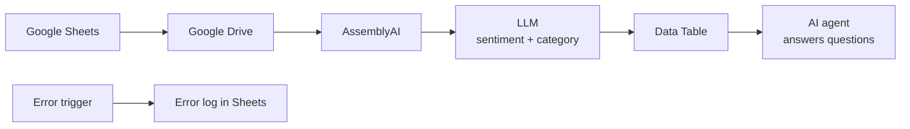

# AI Call Analytics Agent

> Call recordings transcribed, sentiment and category detected by LLM, plus an AI agent that answers questions about call stats.

 

## Problem

- Customer calls were reviewed manually.
- No centralized analytics; negative feedback was hard to find.

## Solution

Built in **n8n**:

1. Checks Google Sheets every 2 minutes
2. Downloads recordings from Google Drive and transcribes them with AssemblyAI
3. LLM detects sentiment (positive / negative / neutral) and call category
4. Saves results to n8n Data Tables and updates the status in Google Sheets
5. AI agent answers natural-language questions about call statistics
6. Separate error-handler workflow logs failed runs, so no recording is lost silently

## Architecture

## Tech stack

- n8n
- OpenRouter (LLM)
- AssemblyAI
- Google Sheets, Drive
- n8n Data Tables
- JavaScript

## Results

- Calls processed automatically in under a minute on average
- Managers ask questions like "how many negative calls this week and why?" in plain language

## Workflow files

The production workflow JSON is not published publicly. I'm happy to walk you through it on a call or adapt it to your stack.

## Case study & demo

Full case study with screenshots and a demo video: **[Notion portfolio](https://tree-plantain-8cf.notion.site)**

## Author

**Kyrylo Kirillov** — AI Automation Engineer (n8n, Make, LLM agents)  
[Upwork](https://www.upwork.com/freelancers/~019bcb1ca9cd59b3ad) · [LinkedIn](https://www.linkedin.com/in/kirillov-kirill) · [Portfolio](https://tree-plantain-8cf.notion.site) · Telegram [@Veter218](https://t.me/Veter218)
